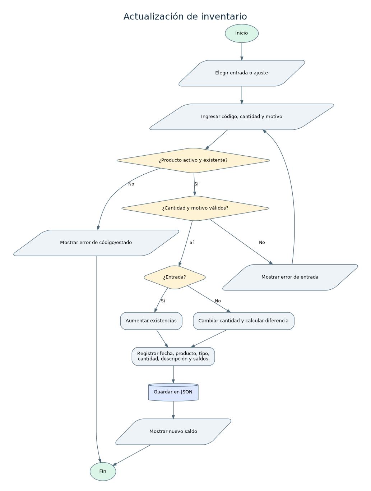

# Análisis: Actualización de inventario

## Nombre del proceso
Actualización de inventario.

## Objetivo
Mantener existencias reales y un historial verificable de entradas y ajustes.

## Descripción del funcionamiento
El operador puede ingresar nuevas unidades o indicar una cantidad real tras un conteo; siempre debe justificar el movimiento.

## Datos de entrada
Opción entrada o ajuste; código; cantidad positiva para entradas o cantidad final no negativa para ajustes; descripción.

## Procesamiento realizado
1. Buscar producto activo. 2. Validar cantidad y motivo. 3. Si entrada, sumar al saldo; si ajuste, calcular diferencia. 4. Generar movimiento con fecha, tipo, código, cantidad, motivo, saldo anterior y nuevo. 5. Guardar archivo.

## Datos de salida
Nuevo stock, registro histórico y alertas de productos que llegaron al stock mínimo.

## Reglas de negocio
No permitir negativos ni diferencias cero en ajuste; los productos desactivados no admiten entradas/ajustes; el stock mínimo alerta cuando cantidad <= mínimo.

## Validaciones y posibles errores
Producto desconocido/inactivo; cantidad o motivo inválidos; ajuste sin cambios; fallo de escritura.

## Diagrama de flujo

Fuente editable en formato DOT: [`actualizacion-inventario.dot`](../diagramas/actualizacion-inventario.dot). Archivo vectorial: [`actualizacion-inventario.svg`](../diagramas/actualizacion-inventario.svg).

## Observaciones técnicas
Los movimientos por ventas también están presentes en el historial con referencia al número de venta.
