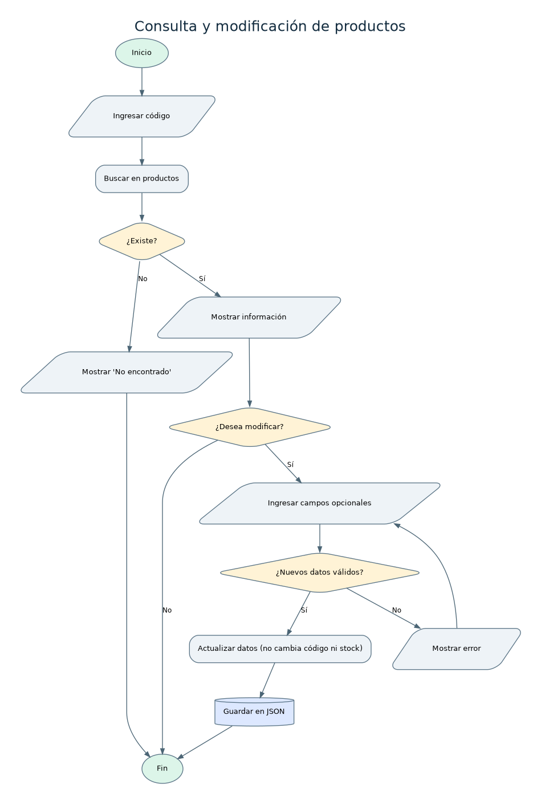

# Análisis: Consulta y modificación de productos

## Nombre del proceso
Consulta y modificación de productos.

## Objetivo
Localizar productos por código y cambiar su información sin perder el historial de ventas.

## Descripción del funcionamiento
El usuario consulta el código; para modificar, primero se busca el producto y luego se solicitan valores opcionales, donde ENTER conserva el dato anterior.

## Datos de entrada
Código; para edición: nombre, categoría, precio y stock mínimo nuevos (opcionales).

## Procesamiento realizado
1. Normalizar código. 2. Buscar en el catálogo. 3. Mostrar datos o informar ausencia. 4. Validar todos los cambios antes de aplicarlos. 5. Cambiar campos elegidos. 6. Guardar.

## Datos de salida
Detalle del producto; confirmación de cambios o mensaje de producto inexistente.

## Reglas de negocio
El código no se modifica; cantidad se ajusta solo desde Inventario para dejar trazabilidad; edición no borra ventas anteriores; desactivar marca activo=falso y no elimina registros.

## Validaciones y posibles errores
Código inexistente; precio negativo; stock mínimo no entero; campos vacíos al reemplazar datos; error al guardar.

## Diagrama de flujo

Fuente editable en formato DOT: [`consulta-modificacion.dot`](../diagramas/consulta-modificacion.dot). Archivo vectorial: [`consulta-modificacion.svg`](../diagramas/consulta-modificacion.svg).

## Observaciones técnicas
El programa permite desactivar productos en Productos > Desactivar; un producto desactivado no puede venderse.
