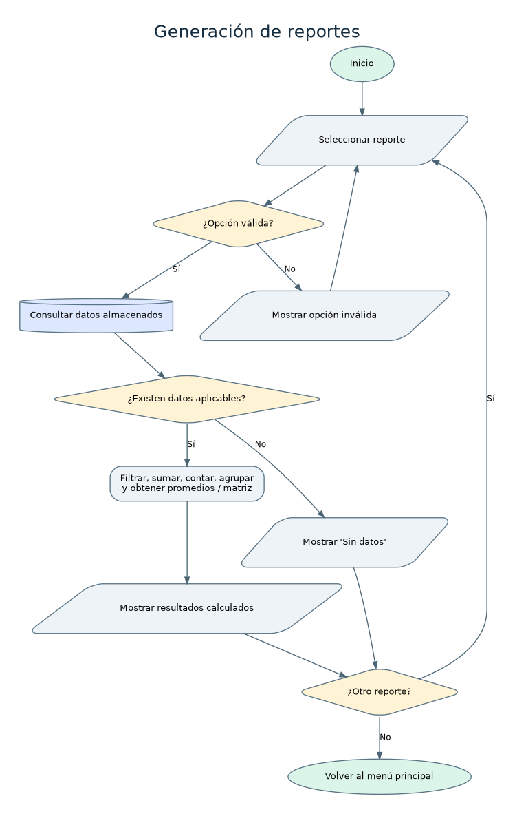

# Análisis: Generación de reportes

## Nombre del proceso
Generación de reportes.

## Objetivo
Proporcionar indicadores actuales calculados a partir de las ventas y del inventario persistido.

## Descripción del funcionamiento
El usuario selecciona un reporte en el submenú. Se toman listas cargadas del archivo, se realizan filtros, sumas, agrupaciones y se muestran resultados.

## Datos de entrada
Tipo de reporte; para promedio de ventas: período diario, mensual o anual; registros de ventas y productos.

## Procesamiento realizado
1. Seleccionar opción válida. 2. Leer listas almacenadas en memoria que fueron cargadas del JSON. 3. Calcular según tipo: stock <= mínimo, sumatoria total de ventas, suma de unidades por código, sumatoria precio x stock, agrupación por fecha y promedio por venta, o matriz de detalles. 4. Mostrar.

## Datos de salida
Listado, alertas, historial, ingresos Q, producto más vendido, valor de inventario activo Q, promedio por período y matriz de ventas.

## Reglas de negocio
Usar datos reales; ingresos incluyen IVA facturado; producto más vendido por UNIDADES, no dinero; inventario valorizado a precio de venta y solo productos activos; promedio = importe total del período / número de ventas en ese período.

## Validaciones y posibles errores
Opción o período inválido; no hay productos/ventas; archivo de datos no disponible al inicio.

## Diagrama de flujo

Fuente editable en formato DOT: [`generacion-reportes.dot`](../diagramas/generacion-reportes.dot). Archivo vectorial: [`generacion-reportes.svg`](../diagramas/generacion-reportes.svg).

## Observaciones técnicas
Matriz de ventas: una fila por producto vendido, con [número de venta, código, cantidad, subtotal de línea]. Si hay empates en el producto más vendido, se prioriza el código alfabéticamente.
