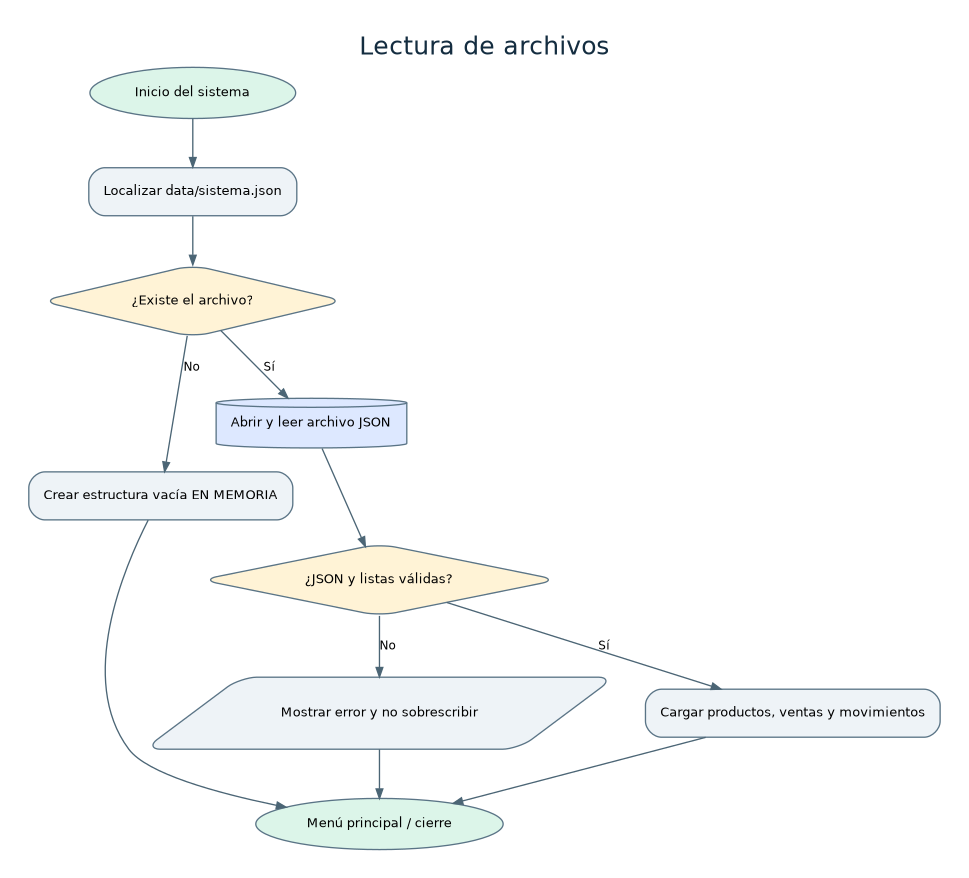

# Análisis: Lectura de archivos

## Nombre del proceso
Lectura de archivos.

## Objetivo
Cargar los datos guardados de ejecuciones anteriores y evitar perder información ante un archivo ilegible.

## Descripción del funcionamiento
Al iniciar, se revisa la ruta del archivo único data/sistema.json. Si falta, se inicia con listas vacías; si existe, se lee y valida la estructura.

## Datos de entrada
Ruta del archivo (predeterminada o variable de entorno SGC_DATA_FILE), contenido JSON.

## Procesamiento realizado
1. Localizar ruta. 2. Comprobar si existe. 3. Si falta, crear datos iniciales en memoria. 4. Si existe, abrir UTF-8, decodificar JSON, comprobar las tres listas esperadas. 5. Retornar datos o error.

## Datos de salida
Diccionario con productos, ventas y movimientos, o error que detiene la aplicación sin escribir el archivo.

## Reglas de negocio
Archivo en UTF-8, formato JSON, listas productos/ventas/movimientos obligatorias; nunca sobrescribir automáticamente un archivo dañado.

## Validaciones y posibles errores
JSON ilegible, falta de permisos, estructura incompleta, ruta inaccesible.

## Diagrama de flujo

Fuente editable en formato DOT: [`lectura-archivos.dot`](../diagramas/lectura-archivos.dot). Archivo vectorial: [`lectura-archivos.svg`](../diagramas/lectura-archivos.svg).

## Observaciones técnicas
Al guardar, se escribe primero un archivo temporal en el mismo directorio y se reemplaza el anterior con os.replace. Es un programa local para un operador a la vez.
