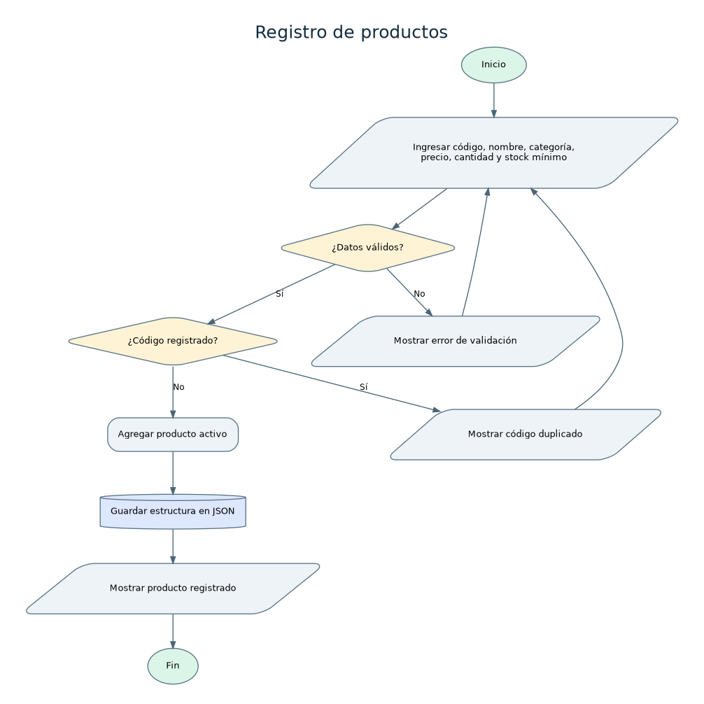

# Análisis: Registro de productos

## Nombre del proceso
Registro de productos.

## Objetivo
Agregar al catálogo un producto único, con información suficiente para vender y controlar su stock.

## Descripción del funcionamiento
El usuario entra a Productos > Registrar, ingresa seis campos, el programa normaliza el código, valida tipos y rangos, descarta códigos usados, agrega el producto activo y guarda el archivo JSON.

## Datos de entrada
Código, nombre, categoría, precio de venta (Q), cantidad inicial y stock mínimo.

## Procesamiento realizado
1. Convertir código a mayúsculas y quitar espacios externos. 2. Revisar campos obligatorios. 3. Verificar precio con dos decimales y cantidades enteras. 4. Buscar código. 5. Agregar diccionario del producto. 6. Guardar datos.

## Datos de salida
Mensaje de éxito y ficha registrada, o mensaje de error con datos sin modificar.

## Reglas de negocio
Código único incluso si el producto ya está desactivado; precio >= 0; cantidad >= 0; stock mínimo >= 0; activo = verdadero al crearse; código no editable.

## Validaciones y posibles errores
Código repetido; texto vacío; precio negativo, no numérico o con más de dos decimales; cantidades negativas o no enteras; error de escritura en disco.

## Diagrama de flujo

Fuente editable en formato DOT: [`registro-productos.dot`](../diagramas/registro-productos.dot). Archivo vectorial: [`registro-productos.svg`](../diagramas/registro-productos.svg).

## Observaciones técnicas
La existencia inicial queda en la ficha del producto. A partir de ahí, entradas, ajustes y ventas generan movimientos de inventario.
