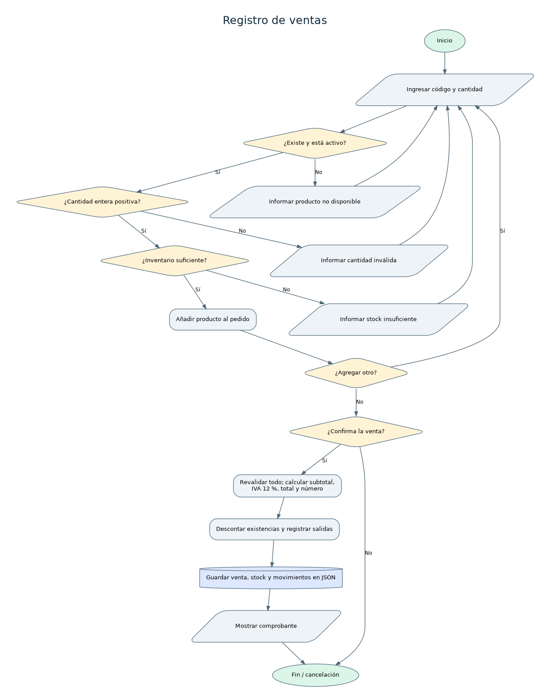

# Análisis: Registro de ventas

## Nombre del proceso
Registro de ventas.

## Objetivo
Cobrar productos existentes, calcular IVA del 12 % y descontar unidades sin generar inventario negativo.

## Descripción del funcionamiento
Se capturan varios productos hasta escribir FIN. El sistema verifica el pedido completo al confirmar, calcula importes, asigna número correlativo, registra la venta y cada salida y guarda todo.

## Datos de entrada
Uno o más pares código/cantidad, confirmación de venta.

## Procesamiento realizado
1. Acumular cantidades por código. 2. Validar existencias y estado activo de cada producto. 3. Calcular subtotal de cada línea y suma. 4. IVA = subtotal x 0.12, con redondeo a centavos. 5. Total = subtotal + IVA. 6. Generar V0001, V0002... 7. Descontar stock. 8. Registrar movimientos SALIDA_VENTA y venta. 9. Guardar los tres conjuntos.

## Datos de salida
Número de venta, fecha, detalle, subtotales, IVA, total, existencias actualizadas e historial.

## Reglas de negocio
Cantidad entera >= 1; producto activo; sumatoria de cantidades del mismo código; stock suficiente para toda la venta; IVA 12 %; no modificar existencias si cualquier producto falla; importe a dos decimales.

## Validaciones y posibles errores
Código inexistente o inactivo; cantidad cero/negativa/no entera; inventario insuficiente; pedido vacío; venta cancelada; error de archivo.

## Diagrama de flujo

Fuente editable en formato DOT: [`registro-ventas.dot`](../diagramas/registro-ventas.dot). Archivo vectorial: [`registro-ventas.svg`](../diagramas/registro-ventas.svg).

## Observaciones técnicas
La operación se guarda en un solo archivo JSON con reemplazo atómico. Si guardar falla, la interfaz restaura el estado anterior en memoria.
