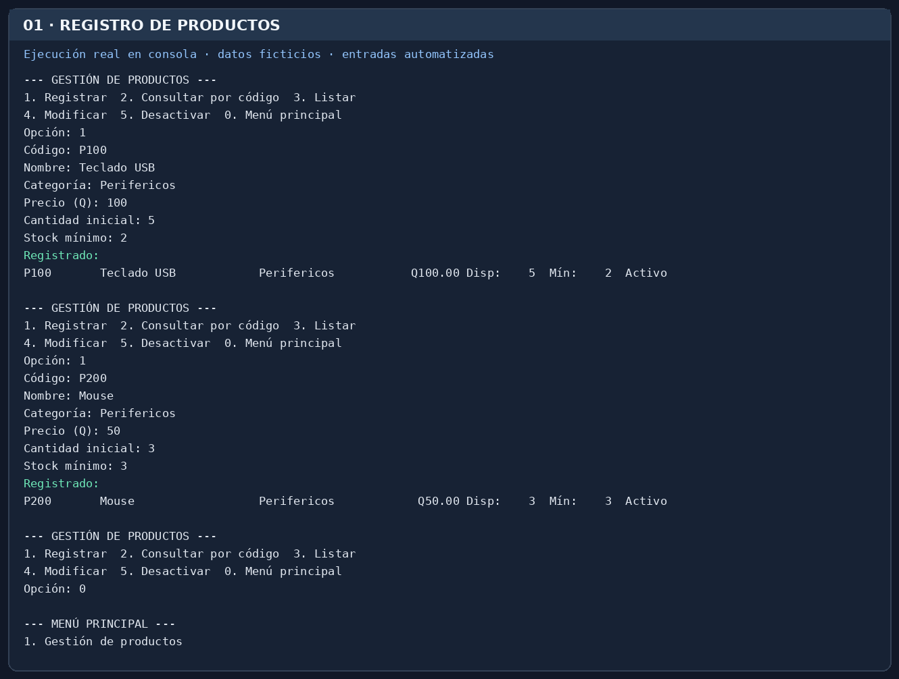
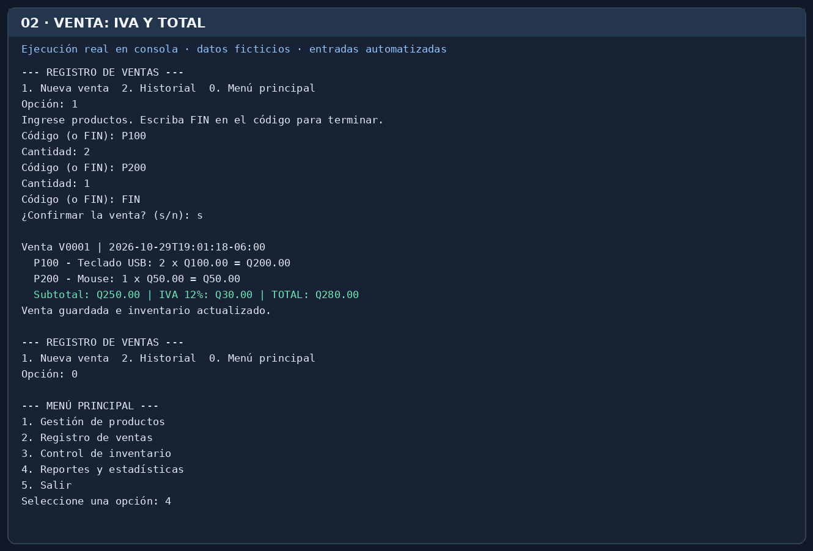
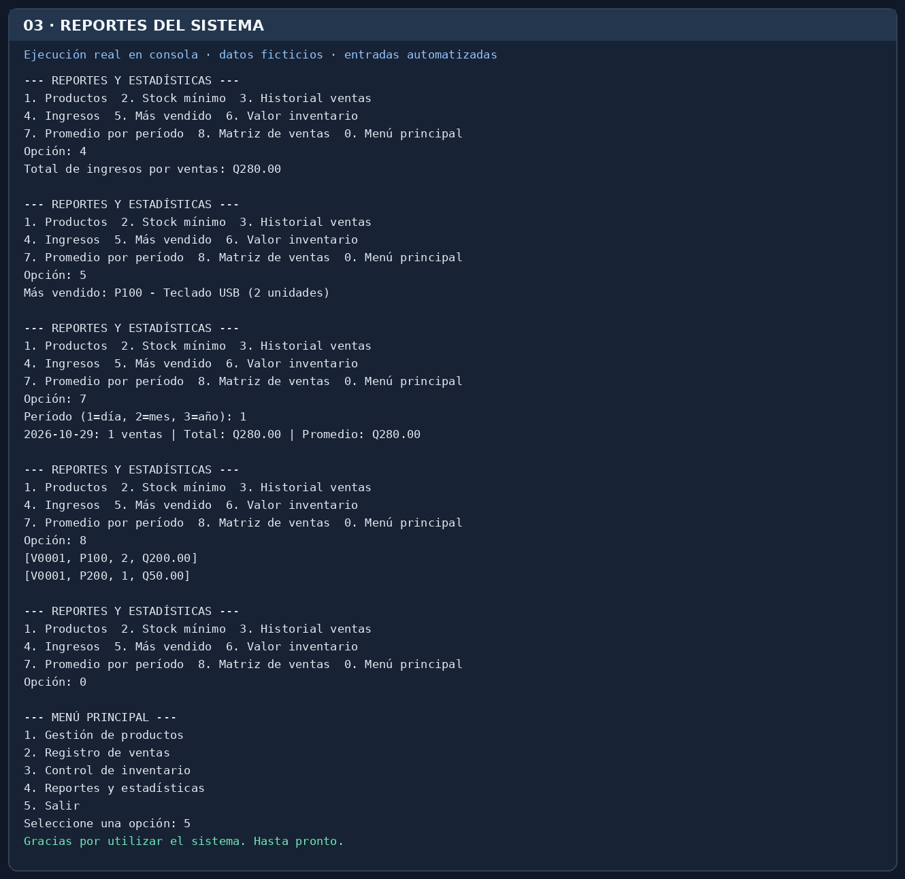

# Manual de usuario — Sistema de Gestión Comercial

## 1. Presentación y propósito

Este programa permite registrar artículos de una pequeña empresa, venderlos,
llevar su inventario y consultar reportes. Se maneja mediante un menú de números.
**No es necesario conocer Python**, solo seguir las instrucciones en pantalla.

## 2. Requisitos para utilizarlo

- Una computadora con Windows, Linux o macOS.
- Python 3.10 o superior instalado.
- La carpeta completa del proyecto descomprimida.
- Permiso de escritura en la carpeta donde se guardan los datos.

## 3. Cómo iniciar y cerrar el programa

1. Abra la carpeta `sistema-gestion-comercial`.
2. Abra una terminal en esa carpeta (en VS Code: **Terminal > Nuevo terminal**).
3. Escriba `python src/main.py` y presione **Enter**. En Windows también puede usar `py src/main.py`.
4. Aparecerá `=== SISTEMA DE GESTIÓN COMERCIAL ===` y el menú principal.
5. Para cerrar con seguridad, desde el menú principal escriba **5** y presione **Enter**.

## 4. Menú principal

| Número | Opción | ¿Para qué sirve? |
|---|---|---|
| 1 | Gestión de productos | Registrar, buscar, ver, modificar, desactivar |
| 2 | Registro de ventas | Crear una venta y revisar su historial |
| 3 | Control de inventario | Ver existencias, entradas, ajustes, alertas y movimientos |
| 4 | Reportes y estadísticas | Obtener indicadores basados en las operaciones guardadas |
| 5 | Salir | Finalizar el programa |

En los submenús, escriba **0** para volver al menú principal. Si escribe otra
opción desconocida aparecerá un aviso y el programa seguirá abierto.

## 5. Registrar, consultar y modificar productos

**Registrar un producto:**
1. Escriba **1** en el menú principal y luego **1** para Registrar.
2. Escriba un código único, por ejemplo `P001`.
3. Ingrese nombre (`Teclado USB`), categoría (`Periféricos`), precio (`100`), cantidad inicial (`5`) y stock mínimo (`2`).
4. Verifique el mensaje de producto registrado. Se guarda automáticamente.

**Consultar:** dentro de Productos elija **2** y escriba el código exacto o en
minúsculas; ambos funcionan. Para ver todos, use **3**.

**Modificar:** elija **4**, indique el código y escriba solo los datos a cambiar.
Pulse Enter en los que desee conservar. Las existencias no se cambian aquí: se
ajustan desde Inventario para dejar historial. Para quitar un producto de venta,
elija **5** y confirme con `s`; el producto queda desactivado, no borrado.

## 6. Registrar una venta

1. Desde el menú principal elija **2** y luego **1**.
2. Escriba un código de producto existente y activo, por ejemplo `P001`.
3. Indique cuántas unidades va a vender, por ejemplo `2`.
4. Repita códigos y cantidades si hay más productos.
5. Escriba **FIN** en el campo Código cuando haya terminado.
6. Escriba **s** para confirmar (cualquier otra respuesta cancela).
7. Se presenta un comprobante con número, fecha, subtotales, IVA del 12 % y total.
8. Los productos vendidos se descuentan automáticamente del inventario.

Para consultar ventas anteriores, elija **2** dentro de Registro de ventas.

**Ejemplo de cálculo:** 2 teclados a Q100 y 1 mouse a Q50:
subtotal Q250, IVA Q30 y total Q280.

## 7. Consultar y actualizar inventario

Desde el menú principal elija **3**.

- **1. Consultar:** se muestran cantidades de todos los productos.
- **2. Entrada:** ingrese código, cantidad recibida (por ejemplo 10) y motivo
  (`Compra a proveedor`). El programa suma las unidades.
- **3. Ajustar:** indique el código, la cantidad **real total** (no la
  diferencia) y el motivo (`Conteo físico`).
- **4. Stock mínimo:** se muestran los productos activos cuya cantidad es igual
  o inferior al mínimo registrado.
- **5. Historial:** muestra cada entrada, ajuste y salida por venta, con fecha,
  código, unidades, saldos y explicación.

## 8. Generar y consultar reportes

Desde el menú principal elija **4**. Los reportes disponibles son:

1. Listado general de productos.
2. Productos con stock mínimo o inferior.
3. Historial de ventas.
4. Suma de ingresos por ventas, con IVA.
5. Producto con mayor cantidad de unidades vendidas.
6. Valor de productos activos en inventario a precio de venta.
7. Promedio de ventas agrupadas por día, mes o año.
8. Matriz de ventas (una fila por producto vendido).

Para el promedio (7), indique **1** día, **2** mes o **3** año.
Los resultados usan los datos registrados; no hay importes de ejemplo fijos.

## 9. Mensajes de error más frecuentes

| Mensaje | Significado y solución |
|---|---|
| `Opción inválida` | Ingrese un número mostrado en el menú. |
| `Ya existe un producto con ese código` | Utilice otro código; los códigos no se repiten. |
| `Producto no encontrado` | Revise el código ingresado. |
| `El precio debe ser numérico` | Ingrese, por ejemplo, `125.50`. |
| `El precio no puede ser negativo` | Ingrese un precio de cero o mayor. |
| `Ingrese un número entero mayor o igual a...` | No escriba letras ni decimales en cantidades. |
| `Inventario insuficiente` | Vender menos unidades o registrar una entrada primero. |
| `está desactivado` | El producto ya no se encuentra disponible para la venta. |
| `No se pudo leer ...` | El archivo de datos tiene un problema; no lo modifique sin respaldo. |

## 10. Ejemplos de uso y capturas

Las siguientes imágenes muestran **resultados de ejecuciones automatizadas del
programa** (capturas de su salida de consola, no datos reales de una empresa).

**Captura de menús y registro:**

**Captura de venta y cálculo de IVA:**

**Captura de reportes y salida:**

Además, el registro de 17 pruebas está en `evidencias/resultado-pruebas.txt`.

## 11. Recomendaciones para conservar los archivos de datos

- La información se guarda en `data/sistema.json`, dentro del proyecto.
- Cierre el programa antes de copiar, restaurar o cambiar ese archivo.
- Guarde periódicamente una copia en USB o una carpeta privada de respaldo.
- No borre ni modifique manualmente `sistema.json`.
- No coloque datos personales o contraseñas en el repositorio público.
- El archivo de ejemplo `data/ejemplo.json` es para practicar y **no** se usa
  automáticamente; para usarlo, cópielo a `data/sistema.json` solo cuando tenga
  respaldo de la información previa.

## Activar y desactivar productos
En Productos, seleccionar un registro y utilizar el boton Activar o Desactivar. El producto conserva su codigo, precio y existencias.

